**Chennai, Tamil Nadu, India**

[GitHub](https://github.com/sabariswaranabc804) · [Email](mailto:sabariswaran812@gmail.com)
<!-- LinkedIn: add once confirmed, e.g. · [LinkedIn](https://www.linkedin.com/in/YOUR-HANDLE) -->

## About

I'm a full stack developer with one year of industry experience building web and mobile applications, from REST API design and database modelling to containerised deployment and CI/CD.

My core stack is **Java and Spring Boot** on the backend, **Angular and React** on the web, and **Flutter** for mobile, with **Node.js and Express** for lighter services. I care about secure authentication (JWT, role-based access control), event-driven communication with Apache Kafka, Redis caching, and clean, maintainable code.

## Featured Projects

Source code for these projects is not currently published on this profile. The diagrams are schematic and show the architecture described for each project.

### HashiBasha Microservices

Restaurant network platform, rebuilt from a monolith into independently deployable services.

`React` `TypeScript` `Tailwind CSS` `Node.js` `Express.js` `PostgreSQL` `Prisma` `Docker`

- Decomposed an Express.js monolith into 7 services using a database-per-service strategy
- Orchestrated the services with Docker and Docker Compose, tuning network proxies and internal event communication
- Built a multi-account SMTP/IMAP email module with OAuth, role-based department routing, and background sync workers

### Bank Token Management System

Token and queue management platform with role-specific dashboards.

`Spring Boot` `Angular` `Apache Kafka` `Redis` `Docker` `GitHub Actions`

- Architected 5 independent Spring Boot microservices with isolated deployments
- Used Apache Kafka for asynchronous token lifecycle events between services
- Cached queue state in Redis to reduce database reads, and delivered 3 role-based Angular dashboards with lazy loading

### HR Management Application

Cross-platform HR app with attendance validation and offline support.

`Flutter` `GetX` `Spring Boot` `MySQL` `Hive`

- Biometric login and GPS validation to prevent proxy attendance
- Offline-first design with Hive, auto-syncing daily records to the Spring Boot backend
- 8 Spring Boot REST APIs covering employee management

## Technical Skills

- **Languages:** Java, JavaScript (ES6+), TypeScript, Dart, SQL, HTML5, CSS3, C
- **Backend:** Spring Boot, Spring Security, Spring Data JPA, Node.js, Express.js, REST APIs, JWT, RBAC
- **Frontend:** Angular 19, React, Tailwind CSS, Bootstrap, Zustand, shadcn/ui
- **Mobile:** Flutter (GetX), Hive
- **Databases:** MySQL, PostgreSQL, MongoDB, Redis, Prisma
- **Messaging & Architecture:** Apache Kafka, event-driven architecture, microservices
- **DevOps & Cloud:** Docker, Docker Compose, GitHub Actions, Render, Vercel, Aiven, AWS (fundamentals)
- **Tools:** Git, GitHub, Cursor, GitHub Copilot, ChatGPT, Gemini, Claude, N8N

## Experience

### Full Stack Developer, Bot Bridge Technologies

Chennai · Jan 2025 – Dec 2025

- Engineered 10+ REST APIs with Spring Boot and Node.js (Express.js), reducing average response time by 30% through structured error handling, input validation, and optimised queries
- Implemented JWT authentication and role-based access control across Admin, Staff, and User roles
- Built a GPS-validated attendance system with geo-fence enforcement, cutting duplicate check-ins by 95% and manual HR intervention by 40%
- Delivered 3 cross-platform Flutter apps and 2 React.js interfaces integrated with real-time APIs
- Optimised MySQL and MongoDB schemas and queries, improving data retrieval speed by 35%

## GitHub Activity

Public activity only.

## Education

**B.Sc. Computer Science**, V.S.S Government College, Pudukkottai · 2021 – 2024 · CGPA 7.0

## Currently Learning

- AWS fundamentals
- Event-driven architecture and advanced microservices patterns
- AI-assisted development and workflow automation with N8N

## Let's Connect

I'm always happy to talk about full-stack engineering, backend systems, or collaboration. Email me at [sabariswaran812@gmail.com](mailto:sabariswaran812@gmail.com).
